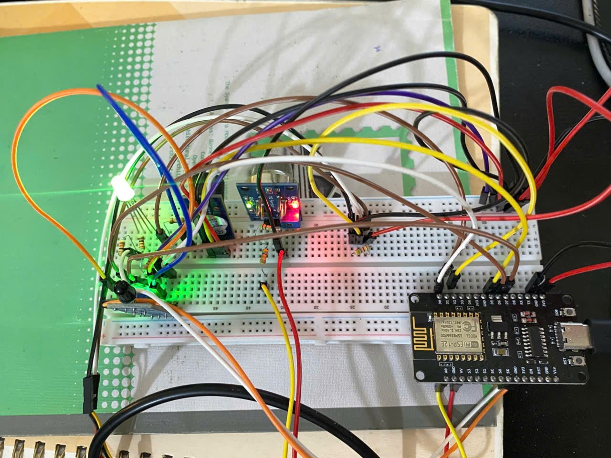
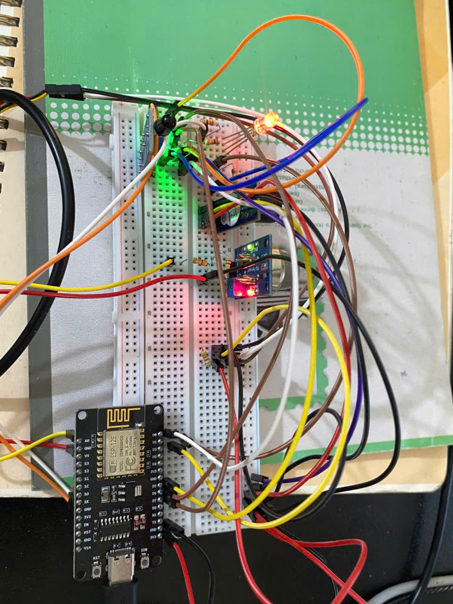

# Ảnh nguyên mẫu node11

Hai ảnh dưới đây chụp cùng một node ESP8266. Xem [sơ đồ nối dây](../wiring.md) và [danh sách linh kiện](../bom.md) để đối chiếu cách lắp mạch.

## Toàn cảnh nguyên mẫu

## Kiểm thử cảnh báo tại chỗ

Ảnh ghi lại thời điểm đèn LED đỏ sáng. Kết quả nghe còi và quan sát LED nhấp nháy cần được ghi riêng theo [kịch bản kiểm thử phần cứng](../../tests/hardware-test-cases.md).
